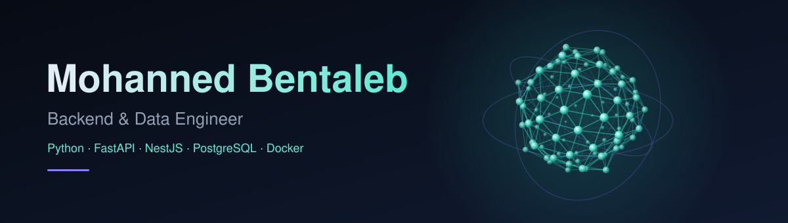

  

  

    
    
    
  

  <a href="https://www.linkedin.com/in/mohanned-ben-taleb-831919312/">LinkedIn</a> ·
  <a href="mailto:mohanned.bentaleb@insat.ucar.tn">Email</a>

---

I'm a software engineering student at INSAT. I build backend services and data pipelines in Python and TypeScript: REST and GraphQL APIs, real-time features, relational design and scraping/ETL. I also use ML and NLP components, and I'm learning how ML algorithms work by re-implementing them from scratch.

## Stack

| | |
|---|---|
| **Languages** | Python · TypeScript/JavaScript · SQL · C/C++ · C# |
| **Backend** | FastAPI · NestJS · Node/Express · ASP.NET Core |
| **Data** | PostgreSQL · SQLite · Redis · Dagster · Playwright |
| **Tools** | Docker · Docker Compose · Git · Linux |
| **ML (used in projects)** | PyTorch · scikit-learn · sentence-transformers · HDBSCAN · FAISS |

## Projects

| Project | What it is | Stack |
|---|---|---|
| [**creator-growth-lab**](https://github.com/mohannedbt/creator-growth-lab) | YouTube analytics platform (solo): ingestion with caching, per-video KPIs, topic clustering and growth verdicts. | FastAPI · ASP.NET Core · HDBSCAN |
| [**QueueFlow**](https://github.com/yassine-krichen/queue-flow-backend) | Real-time interview queue (team of 4). My slice: join codes, join flow, queue state machine, GraphQL queries and the matching frontend. | NestJS · Prisma · PostgreSQL |
| [**AAM — keystroke modality**](https://github.com/PPP-Attention-Adaptive-Manager/Keyboard_Cognitive_load_analysis) | Cognitive-state inference from behavioral metadata (team of 4, poster at AI National Summit 4.0). My part: features, model, dashboard. | Python · PyTorch |
| [**Behavior-Risk-Engine**](https://github.com/mohannedbt/Behavior-Risk-Engine) | Detecting coordinated and automated behavior in social media activity. | Python · NLP |
| [**Chat-nights**](https://github.com/mohannedbt/Chat-nights) | Real-time chat on raw WebSockets. | Node.js |
| [**AI_From_Scratch**](https://github.com/mohannedbt/AI_From_Scratch) | *In progress:* learning how popular libraries work by re-implementing core algorithms. | Python |

<b>Experience</b>

- **Data Engineering Intern, E-tafakna (LegalTech)** — legal-data ingestion pipeline with Playwright scrapers orchestrated as Dagster assets and idempotent ingestion (summer 2026).
- **AINS 4.0 Hackathon, 2nd place** — Massar, a FastAPI microservice system; I built the data collection and a decision-tree startup classifier.

